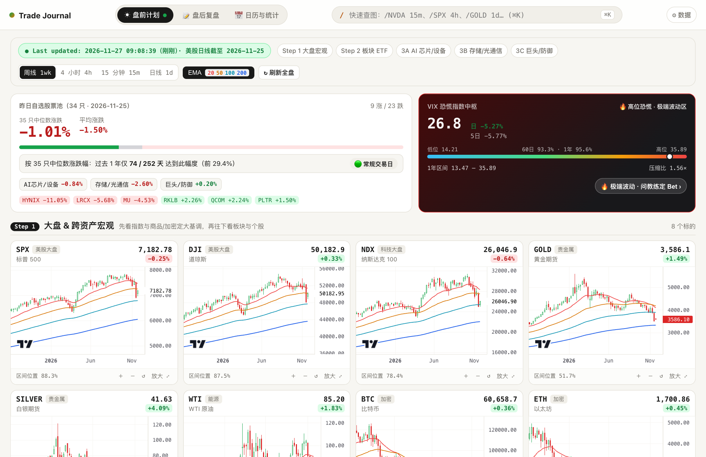
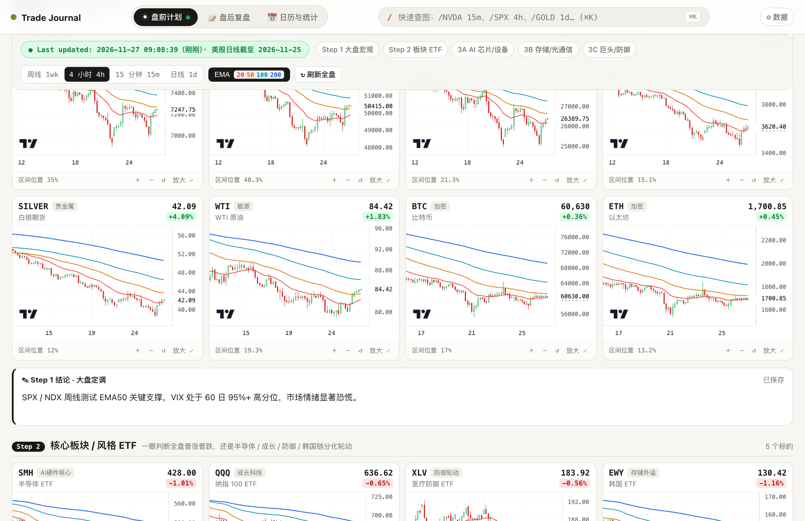
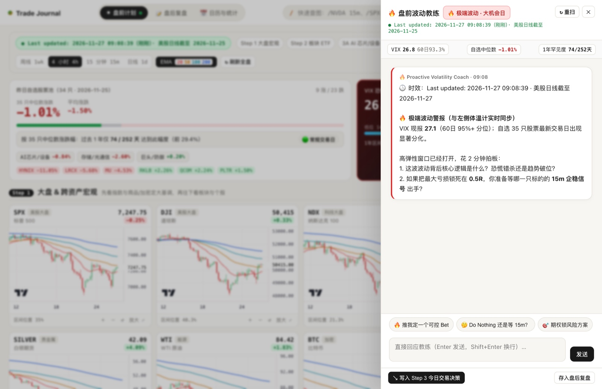
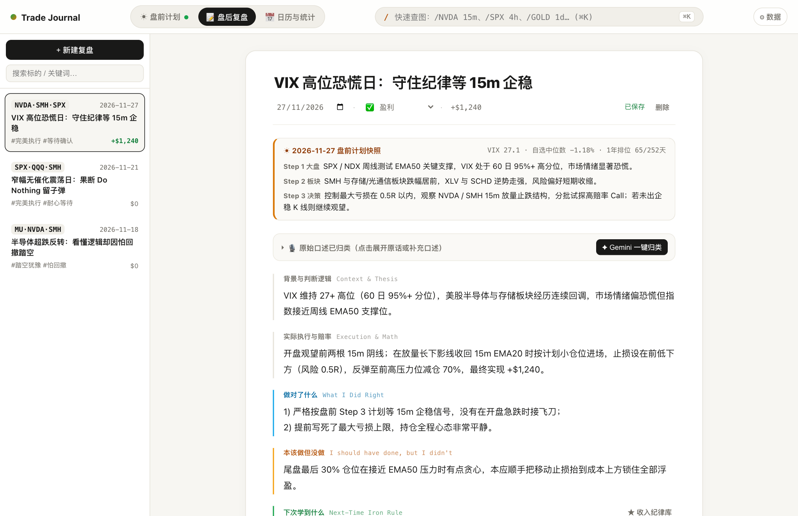
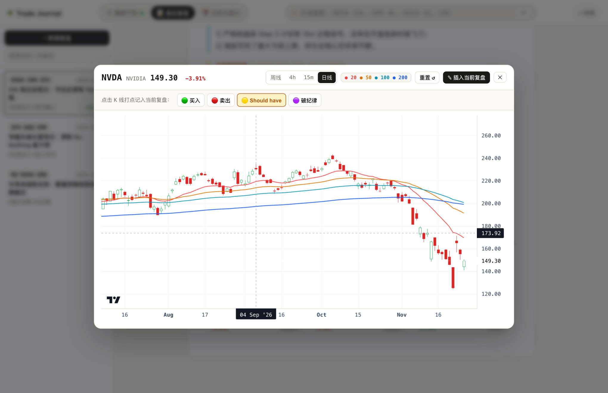
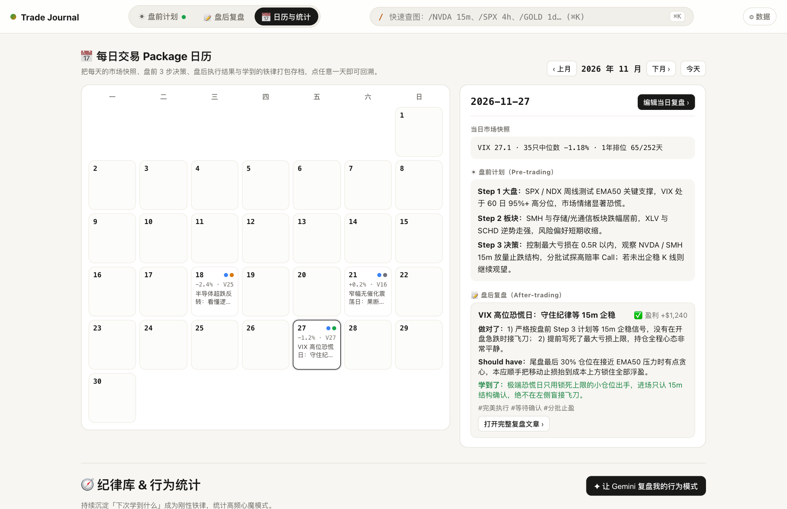
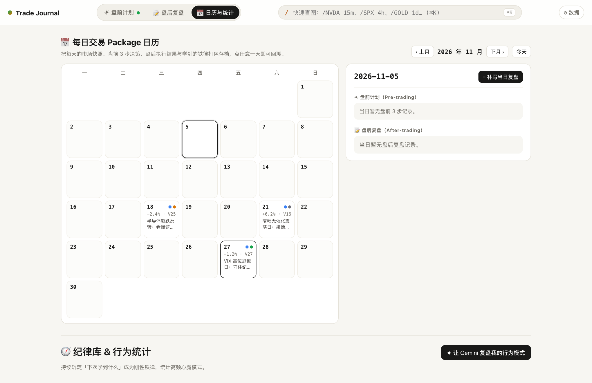
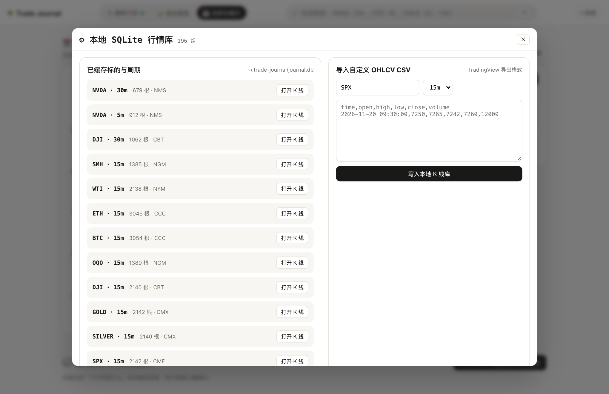
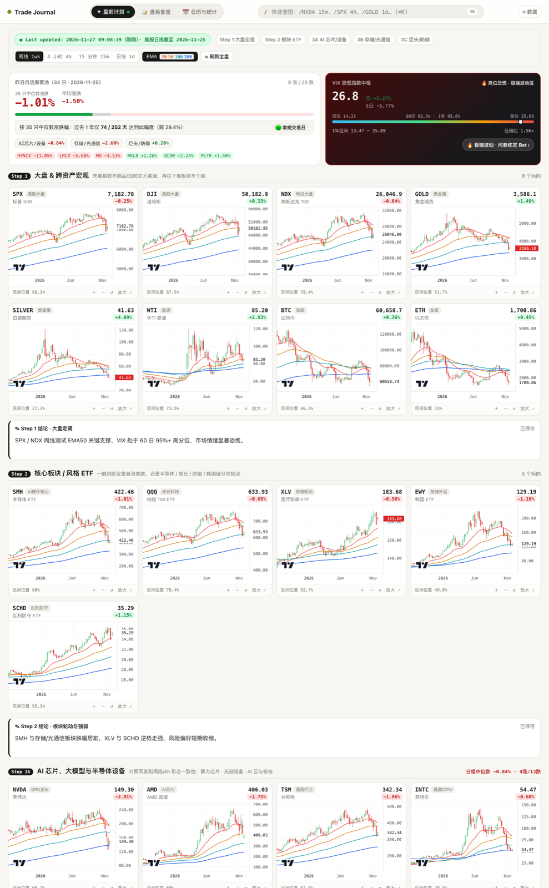

<div align="center">

# Trade Journal

> *「没有盘前定调，盘中每一个波动都是情绪；没有盘后留档，昨天交的学费明天还会再交一次。」*

[](https://www.python.org/)
[](https://fastapi.tiangolo.com/)
[](https://www.sqlite.org/)
[](https://tradingview.github.io/lightweight-charts/)
[](https://ai.google.dev/)
[](LICENSE)

**面向美股与跨资产交易员的本地日终闭环工作台——盘前 3 步 4-EMA 扫图定调，盘后文章式复盘，按日打包归档到日历。**

[长什么样](#长什么样) · [它和同类有什么不同](#它和同类有什么不同) · [架构](#架构) · [快速开始](#快速开始) · [API 参考](#api-参考) · [For AI Agents](#for-ai-agents)

</div>

---

<p align="center"></p>
<p align="center"><sub>盘前计划工作台（周线 1wk）：顶部实时更新时效徽章、35 只自选股中位数体温计与 VIX 恐慌中枢、以及 Step 1 跨资产 4-EMA 交互 K 线墙。</sub></p>

### Capability Contract

- **in**: 48 个跨资产标的（美股指数 / 商品 / 加密 / 核心 ETF / 35 只自选股）行情、盘前 3 步文字定调、盘后口述复盘与粘贴截图、或 TradingView OHLCV CSV
- **out**: `1wk / 4h / 15m / 1d` 四均线（`EMA 20 / 50 / 100 / 200`）交互 K 线墙、自动挂载当日市场快照的文章式复盘、K 线 4 类打点、按日归档的 Package 日历与可统计纪律库
- **fail**: 上游行情限流或断网时自动回退本地 SQLite 历史缓存并标明时效；未配置 `GOOGLE_API_KEY` 时 100% 保留图表、计划、复盘与日历功能，仅停用 AI 归类与波动教练；无记录日期展示可一键补写的空状态
- **Adapters**: Yahoo Finance（日/周线 + `includePrePost` 盘前盘后分钟线 + CME 23 小时指数期货 `ES=F / NQ=F / YM=F`）、TradingView OHLCV CSV、Google Gemini 快慢双模型（默认 `gemini-3.8-flash` 口述归类 + `gemini-4-neon` 深度推理教练/审计，可选）

---

## 它解决什么问题

大多数交易日志坚持不过两周，原因很具体：早盘开着二十几个 TradingView 标签页，盘前想法记在备忘录，盘后截图散落在桌面，下周再遇到同一种波动时，早已忘了上次是怎么踩坑的。

Trade Journal 把交易员每天最核心的动作收拢到一个本地单页工作台的三个标签里：

1. **☀ 盘前计划（Pre-trading）**：10 秒看清市场体温（35 只自选股中位数涨跌 + 过去 1 年罕见度排位 + VIX 分位），按 **Step 1 大盘宏观 → Step 2 板块 ETF → Step 3 个股** 依次扫图，直接在每一步下方写下结论并冻结当日市场快照；遇到 VIX 高位波动日，可从右侧滑出 **盘前波动教练** 协助收口风控边界。
2. **📝 盘后复盘（After-trading）**：以居中文章纸（Article Sheet）呈现完整复盘——顶部自动带入早盘快照，中间用非侵入的五段结构记录「背景逻辑 / 实际执行与赔率 / 做对了什么 / 本该做但没做 / 下次学到什么」，文末用 `#标签` 归类，随时插入点击可放大打点的 K 线小图或 `Cmd+V` 粘贴截图。
3. **📅 日历与统计（Track Everything）**：每天的「市场快照 + 盘前 3 步 + 盘后结果与铁律」打包成一个 **Daily Package** 存进月历，点击任意一天即可完整回溯，并把高频教训沉淀为可统计命中次数的纪律库。

---

## 长什么样

### 盘前计划：多周期扫图、内联结论与盘前波动教练

<table>
  <tr>
    <td width="50%" valign="top">
      
      <sub><b>4h 连续盘前盘后与 Step 1 结论框</b>：全局一键切换 <code>1wk / 4h / 15m / 1d</code>，美股指数盘中自动映射 CME 23 小时连续期货，每一步底部就地写结论并自动保存。</sub>
    </td>
    <td width="50%" valign="top">
      
      <sub><b>盘前波动教练抽屉（仅盘前出现）</b>：实时同步 VIX 与自选中位数，辅助明确最大亏损与触发条件，结论可一键写入 Step 3 今日决策。</sub>
    </td>
  </tr>
</table>

### 盘后复盘：文章式排版与 K 线放大打点

<table>
  <tr>
    <td width="50%" valign="top">
      
      <sub><b>文章式盘后复盘</b>：顶部自动挂载当日盘前快照，支持展开原始口述由 Gemini 一键拆解为五段结构，文末集中管理 <code>#标签</code> 与可放大 K 线小图。</sub>
    </td>
    <td width="50%" valign="top">
      
      <sub><b>交互式 K 线放大与打点</b>：空心绿阳 / 实心红阴蜡烛 + 4 条 EMA 均线带，支持 X/Y 轴缩放拖拽与「买入 / 卖出 / Should have / 破纪律」四类打点。</sub>
    </td>
  </tr>
</table>

### 日历归档、空日状态与本地数据底座

<table>
  <tr>
    <td width="50%" valign="top">
      
      <sub><b>每日 Package 日历</b>：月历格展示当日中位数涨跌、VIX 与计划/复盘状态圆点，点选任意日期在右侧对照盘前定调与盘后执行。</sub>
    </td>
    <td width="50%" valign="top">
      
      <sub><b>无记录日期空态</b>：点击尚未记录的交易日清晰展示空状态，并提供 <code>+ 补写当日复盘</code> 直接进入当日编辑。</sub>
    </td>
  </tr>
</table>

<p align="center"></p>
<p align="center"><sub><b>本地 SQLite 行情库与 CSV 导入</b>：随时查看本地已缓存的标的和 K 线根数，也支持直接粘贴 TradingView 导出的 OHLCV CSV 写入本地库。</sub></p>

<details>
<summary>展开查看盘前计划完整长图（市场体温计 + Step 1 宏观 + Step 2 ETF + Step 3A AI 算力）</summary>
<br>
<p align="center"></p>
</details>

---

## 它和同类有什么不同

| 维度 | Trade Journal | Notion / Excel 表格 | TradingView | 云端 SaaS 日志（TraderSync 等） |
| :--- | :--- | :--- | :--- | :--- |
| **盘前→盘后因果关联** | 盘前 3 步自动冻结市场快照，盘后复盘顶部自动挂载 | 需手工复制粘贴 | 无结构化复盘日历 | 偏重成交明细统计，弱化盘前逻辑 |
| **多标的同屏 4-EMA 扫图** | 48 标的按 3 步分层铺开，全局一键切 `1wk/4h/15m/1d` | 无原生交互 K 线 | 多图布局受付费席位限制 | 仅针对已成交单笔出图 |
| **复盘形态** | 居中文章纸 + 段落标注 + 内嵌可打点 K 线小图 | 自由文档，容易格式散乱 | 仅图表注释 | 表单字段繁杂 |
| **数据归属与费用** | 100% 本地 SQLite，无订阅费，零 API Key 可运行 | 云端托管 | 按档位订阅 | 月费订阅，需上传券商对账单 |
| **离线 / 限流容错** | 本地缓存历史 K 线 + TradingView CSV 兜底 | 依赖网络 | 依赖网络 | 依赖云端服务 |

---

## 架构

```text
┌─────────────────────────────────────────────────────────────────────────┐
│                    Browser UI (Single-Page Editorial Desk)              │
│   Tab 1: ☀ 盘前计划      Tab 2: 📝 盘后复盘      Tab 3: 📅 日历与统计     │
│   Lightweight Charts (4-EMA) · Volatility Coach Drawer · Cmd+K查图       │
└───────────────────────────────┬─────────────────────────────────────────┘
                                │ HTTP / JSON (127.0.0.1:8796)
                                ▼
┌─────────────────────────────────────────────────────────────────────────┐
│                       FastAPI Backend (app.py)                          │
│  ┌──────────────┐  ┌───────────────┐  ┌──────────────┐  ┌────────────┐ │
│  │  morning.py  │  │   market.py   │  │   radar.py   │  │  Coach/AI  │ │
│  │ 48标的体温计 │  │ 多周期聚合去重 │  │ 市场波动评级 │  │ Gemini(选) │ │
│  │ 3步快照引擎  │  │ Pre/Post+CME  │  │ VIX 分位标尺 │  │ 口述结构化 │ │
│  └──────┬───────┘  └───────┬───────┘  └──────┬───────┘  └─────┬──────┘ │
│         └──────────────────┴────────┬────────┘                │        │
│                                     ▼                         │        │
│                    ┌─────────────────────────────────┐        │        │
│                    │  db.py · ThreadSafe SQLite WAL  │        │        │
│                    │  ~/.trade-journal/journal.db    │        │        │
│                    │  ~/.trade-journal/media/        │        │        │
│                    └─────────────────────────────────┘        │        │
└─────────────────────────────────┬─────────────────────────────┼────────┘
                                  │                             │
                  ┌───────────────▼──────────────┐   ┌──────────▼────────────┐
                  │ Yahoo Finance / TV CSV Input │   │ Gemini Fast + Pro AI  │
                  │   (行情拉取 · 失败读本地缓存)  │   │ (可选 · 按场景分层路由) │
                  └──────────────────────────────┘   └───────────────────────┘
```

---

## 快速开始

### 1. 安装与启动（零 API Key 即可完整运行）

```bash
git clone https://github.com/zinan92/trade-journal.git
cd trade-journal
python3 -m pip install -e ".[dev]"

# 启动本地工作台（默认 http://127.0.0.1:8796）
PYTHONPATH=src python3 -m trade_journal.server serve --port 8796
```

启动后在浏览器打开 `http://127.0.0.1:8796` 即可使用全部图表、盘前计划、盘后复盘、日历与 CSV 导入功能。

### 2. 可选：启用 Gemini AI 能力（支持 API Key 或本地 CLI 免 Key，快慢双模型分层）

若需要「盘后口述一键归类」、「盘前波动教练对话」与「行为模式复盘」，支持三种后端（通过 `GEMINI_PROVIDER=auto|api|agy|gemini-cli` 控制，默认 `auto` 自动检测）：

1. **Gemini API Key（直连 HTTP，延迟最低）**：设置 `GOOGLE_API_KEY` 或 `GEMINI_API_KEY`（示例见 [`.env.example`](.env.example)）。
2. **Antigravity CLI（`agy`，个人账号免 API Key）**：安装并登录 `agy` 后，无需配置 Key 即可直接通过无头模式调用（Fast 用 `--effort low`，Pro 用 `--effort high`）。
3. **Gemini CLI（`gemini`，需企业/GCP 授权或 Key）**：自动以 `--skip-trust -o json` 无头调用。

系统默认按任务难度分层路由：

- **快速层（`GEMINI_FAST_MODEL`，默认 `gemini-3.8-flash`）**：用于「盘后 Gemini 一键归类」，低延迟、严格输出 JSON。
- **深度推理层（`GEMINI_PRO_MODEL`，默认 `gemini-4-neon`，默认开启 `thinkingLevel=high`）**：用于「盘前波动教练」与「行为模式审计」，做赔率风控推演与跨多篇复盘的深度洞察。

```bash
# 方式 A：使用 Gemini API Key
export GOOGLE_API_KEY="your-gemini-api-key"
# 方式 B：免 Key 使用已登录的 Antigravity CLI (`agy`)
# export GEMINI_PROVIDER="agy"
PYTHONPATH=src python3 -m trade_journal.server serve --port 8796
```

### 3. 可选：macOS 每日 09:00 自动拉起盘前工作台

仓库自带 [`scripts/morning_popup.sh`](scripts/morning_popup.sh)，会自动检测本地端口是否已启动、按需后台拉起服务并打开 `?view=morning`：

```bash
chmod +x scripts/morning_popup.sh
./scripts/morning_popup.sh
```

可配合 `launchd`（`StartCalendarInterval` 设为 `Hour=9, Minute=0`）实现每个交易日早间自动弹窗提醒。

### 4. 可选：一键复现公开演示截图

```bash
python3 scripts/capture_screenshots.py
```

脚本会在临时目录构造干净的演示 SQLite 数据库并在独立端口 `18799` 启动服务，通过 Playwright 重新生成 `docs/screenshots/` 下的全套截图，不会污染真实数据。

---

## 功能一览

- **48 标的跨资产自上而下观察池**
  - **Step 1 宏观与跨资产（8）**：`SPX, DJI, NDX, GOLD, SILVER, WTI, BTC, ETH`
  - **Step 2 核心板块 ETF（5）**：`SMH, QQQ, XLV, EWY, SCHD`
  - **Step 3 自选股池（35）**：按 `3A AI 芯片与设备 (17)`、`3B 存储 HBM & 光通信 (9)`、`3C 科技巨头与防御 (9)` 分组平铺，自动计算 35 股中位数/平均涨跌及过去 1 年（252 交易日）罕见度排位。
- **专业 K 线引擎（TradingView Lightweight Charts）**
  - **四均线体系**：SMA 预热种子法计算 `EMA 20`（红）/ `EMA 50`（琥珀）/ `EMA 100`（青）/ `EMA 200`（蓝），日线拉取 2 年、周线拉取 10 年以保证 `EMA 200` 充分预热。
  - **盘前盘后连续行情**：分钟线开启 `includePrePost=true`；美股指数（`SPX / NDX / DJI`）在 `4h / 15m` 周期自动映射 CME 23 小时连续期货（`ES=F / NQ=F / YM=F`），避免隔夜跳空断层；内置实时未收盘 Bar 去重逻辑，防止期货秒级时间戳导致重复红柱。
  - **完整交互与打点**：空心绿阳 / 实心红阴蜡烛，支持滚轮缩放、X/Y 轴拖拽、双击复位、`Cmd+K` 快速查图（如 `/NVDA 15m`、`/GOLD 1d`），并在放大弹窗中支持「买入 / 卖出 / Should have / 破纪律」四类打点。
- **线程安全本地 SQLite 底座**
  - `ThreadSafeConnection` 为每个 FastAPI 工作线程维护独立 WAL 连接，并在写操作层加锁，并发强制刷新全盘行情与保存计划时不发生游标冲突。

---

## API 参考

| Method | Endpoint | 说明 |
| :--- | :--- | :--- |
| `GET` | `/api/morning/summary?force=false` | 获取市场体温计（35 股中位数、1 年罕见度排位、VIX 分位与时效时间戳） |
| `GET` | `/api/morning/charts?interval=1wk&force=false` | 获取 48 标的分组 K 线数据（支持 `1wk / 4h / 15m / 1d`） |
| `GET / POST` | `/api/plans/today` | 读取或自动保存当日 Step 1/2/3 盘前结论，并冻结 `market_snapshot_json` |
| `GET / POST` | `/api/entries` | 查询复盘列表或新建盘后复盘文章 |
| `PATCH / DELETE` | `/api/entries/{entry_id}` | 更新复盘五段正文、盈亏、`#标签` 与关联 K 线标的 |
| `POST` | `/api/entries/{entry_id}/organize` | 调用 Gemini 将原始口述拆解到五个复盘段落（可选） |
| `POST / PATCH / DELETE` | `/api/entries/{entry_id}/markers` | 新增、修改或删除某条复盘关联的 K 线打点 |
| `POST` | `/api/entries/{entry_id}/attachments` | 上传剪贴板粘贴的本地复盘截图 |
| `GET / POST / DELETE` | `/api/events` · `/api/events/{id}` | 查询关键市场事件与今日大波动预警（FOMC / 非农 CPI / 核心财报 / 假日半天盘 / 四巫日），或增删自定义提醒 |
| `GET` | `/api/calendar?month=YYYY-MM` | 按月返回每日 Package 摘要（市场快照 + 计划/复盘标记 + 关键事件日历） |
| `GET` | `/api/packages/{plan_date}` | 获取指定日期的完整 Daily Package（市场快照 + 盘前 3 步 + 盘后复盘） |
| `GET / POST` | `/api/coach/state` · `/api/coach/reply` · `/api/coach/commit` | 盘前波动教练状态、对话与一键写入 Step 3 决策（可选） |
| `GET` | `/api/candles?symbol=NVDA&interval=1d` | 拉取单标的多周期 K 线（优先命中本地 SQLite 缓存） |
| `POST` | `/api/candles/import-csv` | 导入 TradingView 导出的 OHLCV CSV 到本地 SQLite |
| `POST` | `/api/rules` · `/api/rules/{rule_id}/hit` | 新建交易纪律铁律或记录违纪/命中次数 |

---

## 技术栈

- **后端**：Python 3.11+ · FastAPI · Uvicorn · `httpx` · SQLite3（WAL 模式）
- **前端**：原生 ES Module + HTML/CSS（零构建步骤、即改即刷新）· TradingView `lightweight-charts`
- **AI（可选）**：Google Gemini API（快慢分层：默认 `gemini-3.8-flash` + `gemini-4-neon` 深度思考，支持环境变量覆盖）
- **测试与截图验证**：`pytest` · Playwright

---

## 项目结构

```text
trade-journal/
├── pyproject.toml                  # 包配置、依赖与 CLI 入口 (trade-journal)
├── .env.example                    # 可选环境变量说明
├── LICENSE                         # MIT License
├── docs/
│   └── screenshots/                # 公开安全的演示界面截图
├── scripts/
│   ├── capture_screenshots.py      # 隔离演示库 Playwright 自动截图脚本
│   └── morning_popup.sh            # macOS 每日盘前自动启动与打开脚本
├── src/trade_journal/
│   ├── ai.py                       # Gemini 快慢双模型路由与跨代 thinkingConfig 适配
│   ├── app.py                      # FastAPI 路由、复盘/日历/教练与 Gemini 接口
│   ├── db.py                       # ThreadSafe SQLite WAL 数据层与表结构迁移
│   ├── events.py                   # 关键市场事件日历（FOMC / CPI / 财报 / 假日 / 四巫日）与今日大波动预警引擎
│   ├── market.py                   # Yahoo Finance 抓取、Pre/Post 聚合、Bar 去重与 CSV 导入
│   ├── morning.py                  # 48 标的观察池、35 股体温计与 1 年罕见度排位计算
│   ├── radar.py                    # VIX 恐慌中枢与极端波动评级
│   ├── server.py                   # 本地服务启动入口 (默认 127.0.0.1:8796)
│   └── static/                     # 单页前端资源 (index.html / app.js / style.css)
└── tests/
    └── test_journal.py             # API、CSV 导入、K 线去重与多线程 SQLite 并发测试
```

---

## 配置

| 环境变量 | 默认值 | 是否必需 | 说明 |
| :--- | :--- | :---: | :--- |
| `TRADE_JOURNAL_DATA` | `~/.trade-journal` | 否 | 本地 SQLite 数据库 (`journal.db`) 与复盘截图 (`media/`) 存储目录 |
| `GEMINI_PROVIDER` | `auto` | 否 | AI 后端选择：`auto`（依次尝试 API Key → `agy` CLI → `gemini` CLI）、`api`、`agy`、`gemini-cli` |
| `GOOGLE_API_KEY` | 无 | 否 | Gemini API Key（也兼容 `GEMINI_API_KEY`），使用 `agy` CLI 时可留空 |
| `GEMINI_FAST_MODEL` | `gemini-3.8-flash` | 否 | 盘后「口述一键归类」使用的快速模型 |
| `GEMINI_PRO_MODEL` | `gemini-4-neon` | 否 | 盘前「波动教练」与日历页「行为模式复盘」使用的强推理模型（免费层可设为 `gemini-3.8-flash`） |
| `GEMINI_PRO_THINKING` | `high` | 否 | 强推理模型的思考深度（Gemini 3+/4 支持 `low / medium / high / xhigh`；`agy` 自动映射为 `--effort`；Gemini 2.5 支持整数 budget 或 `-1`） |

> **零 API Key 基线**：不配置任何环境变量即可 100% 正常使用盘前 48 标的 4-EMA 扫图、3 步计划、盘后文章复盘、K 线打点、截图粘贴、每日 Package 日历、纪律库统计与 CSV 导入。

---

## 安全边界

- **本地数据主权**：所有复盘文章、盘前计划、截图与 K 线缓存均仅写入本机 `~/.trade-journal/`，无任何云端同步、埋点或遥测。
- **不接触券商与资金**：无券商账号连接、无交易 API Key、无任何自动下单或执行能力，纯粹用于研究规划与行为复盘。
- **按需调用 AI**：仅当用户显式点击「Gemini 一键归类」「行为复盘」或向「盘前波动教练」发送消息时才对外请求 Gemini API，不会后台静默上传日记。
- **服务仅绑定回环地址**：默认监听 `127.0.0.1:8796`，不向局域网或公网暴露端口。

---

## For AI Agents

```yaml
capability: local_trade_journal_workbench
version: "0.1.0"
transport: http_json
default_base_url: "http://127.0.0.1:8796"
auth_required: false
optional_env:
  - GOOGLE_API_KEY
  - GEMINI_FAST_MODEL
  - GEMINI_PRO_MODEL
  - GEMINI_PRO_THINKING
  - TRADE_JOURNAL_DATA
inputs:
  market_summary: "GET /api/morning/summary?force=false"
  charts: "GET /api/morning/charts?interval=1wk|4h|15m|1d&force=false"
  daily_plan: "POST /api/plans/today {plan_date, step1_note, step2_note, step3_note}"
  journal_entry: "POST /api/entries {trade_date, title, symbol, symbols, raw_note, context_note, execution_note, did_right_note, should_have_note, takeaway_note, bias_tags}"
  daily_package: "GET /api/packages/{YYYY-MM-DD}"
outputs:
  sqlite_db: "~/.trade-journal/journal.db"
  media_dir: "~/.trade-journal/media/"
  package_schema: "{ok, date, plan, entries}"
failure_modes:
  - condition: "Upstream Yahoo Finance rate limit or offline"
    behavior: "Serves cached SQLite candles with explicit fetched_at staleness metadata; accepts TradingView OHLCV CSV via POST /api/candles/import-csv"
  - condition: "Missing GOOGLE_API_KEY"
    behavior: "Core endpoints return 200 normally; /organize, /ai/review, and /coach/reply return structured error advising key setup"
```

使用 Python `httpx` 读取当日市场体温计、写入盘前 3 步计划并拉取完整 Daily Package：

```python
import httpx

BASE = "http://127.0.0.1:8796"

with httpx.Client(base_url=BASE, timeout=15.0) as client:
    summary = client.get("/api/morning/summary").json()
    print("VIX:", summary["vix"]["price"], "35-stock median:", summary["thermometer"]["medianPct"])

    client.post(
        "/api/plans/today",
        json={
            "plan_date": "2026-11-27",
            "step1_note": "SPX/NDX 周线测试 EMA50，VIX 高位保持敬畏。",
            "step2_note": "SMH 领跌、XLV/SCHD 防御走强，控制仓位弹性。",
            "step3_note": "最大亏损锁死 0.5R，等待 NVDA 15m 放量止跌确认。",
        },
    ).raise_for_status()

    pkg = client.get("/api/packages/2026-11-27").json()
    print("Saved package entries:", len(pkg["entries"]))
```

---

## 验证与测试

运行端到端与并发回归测试套件（覆盖启动自检、CSV 导入、K 线日/周/盘中未收盘 Bar 去重、复盘 CRUD 与打点、以及 8 线程并发写入 SQLite WAL 压力测试）：

```bash
PYTHONPATH=src python3 -m pytest -v
```

测试预期全部通过（`12 passed`）。

---

## License

[MIT](LICENSE)
